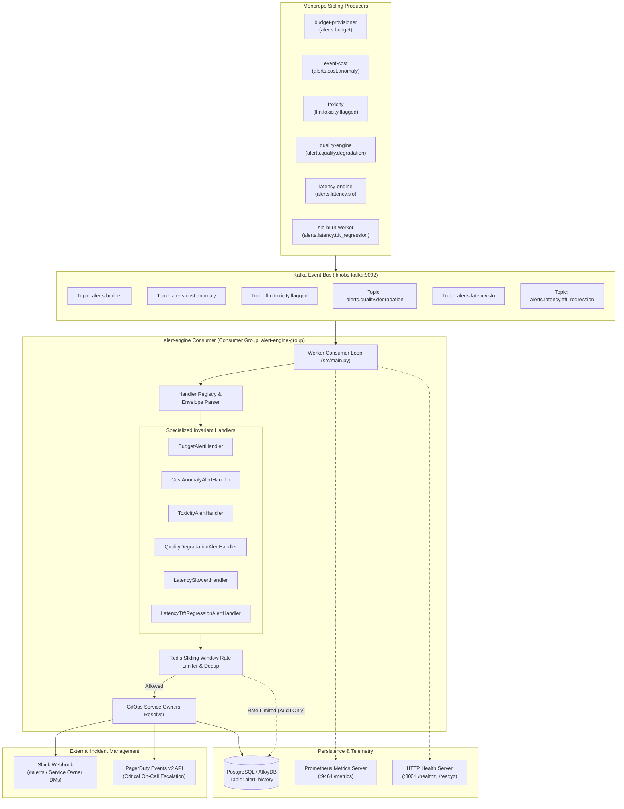

# LLM Observability — Alert Engine (`alert-engine`)

A resilient, cloud-native incident dispatch, anomaly detection, and notification routing engine for high-throughput LLM observability platforms.

---

## 1. What is this Package?

The **`alert-engine`** is an event-driven worker service within the `llm-obs` platform. It continuously consumes, processes, deduplicates, and dispatches critical anomaly events emitted by sibling workers across the monorepo:
* **Cost & Budget Breaches**: Real-time token budget exhaustion from `budget-provisioner` and EWMA cost spikes from `event-cost`.
* **Safety & Guardrails**: Content moderation flags and toxic prompt/completion breaches from `toxicity`.
* **Inference Quality Degradation**: Semantic drift, coherence erosion, and perplexity degradation from `quality-engine`.
* **Latency & SLO Regressions**: P95/P99 latency breaches from `latency-engine` and Time-To-First-Token (TTFT) regressions from `slo-burn-worker`.

It serves as the central intelligent routing layer between asynchronous telemetry event streams and real-time operational incident management channels (Slack webhooks, PagerDuty Events API v2), backed by distributed sliding-window rate limiting in Redis and relational audit trails in AlloyDB/PostgreSQL.

---

## 2. Exactly Why Do We Need This? (The Problem It Solves)

In modern enterprise LLM architectures, models are non-deterministic, usage-priced, and prone to silent failures. Operating production LLM systems without a dedicated alert engine leads to critical systemic vulnerabilities:

### 2.1 Preventing Catastrophic Runaway Cost Overruns
* **The Problem**: A rogue prompt recursion or automated agent loop can execute thousands of GPT-4/Claude-3 queries in minutes, rapidly accumulating tens of thousands of dollars before humans notice.
* **The Solution**: `alert-engine` consumes real-time `alerts.budget` and `alerts.cost.anomaly` events. Upon a hard ceiling breach, it notifies engineering teams instantly and flags budget blocks to stop further drain.

### 2.2 Eliminating Alert Fatigue & Notification Storms (Zero-Spam Deduplication)
* **The Problem**: When an LLM endpoint degrades or is rate-limited, every concurrent user query fails. Naive alert listeners blast on-call engineers with tens of thousands of duplicate Slack notifications and pager sirens within seconds.
* **The Solution**: Incorporates distributed sliding-window rate limiting and fingerprint deduplication using Redis. Alerts for the same `(tenant_id, alert_type, service)` are capped (e.g. max 5 alerts per 5-minute window). Once an incident is marked `ACKNOWLEDGED`, repetitive notifications are suppressed while raw occurrences continue to be logged for historical audit trails.

### 2.3 Context-Aware GitOps Routing (Right Alert to the Right Person)
* **The Problem**: Sending all platform alerts into a generic channel causes teams to ignore notifications. Sending cost alerts to engineers who do not own the offending service leads to delayed resolution.
* **The Solution**: Dynamically resolves service ownership from GitOps manifests (`config/service_owners.yaml`). Budget warnings (80% ceiling) are sent directly to service owners via Slack DMs, budget exhaustion goes to `#llm-cost-alerts`, and severe P1 latency breaches trigger escalated on-call PagerDuty incidents.

### 2.4 Immutable Auditability & Compliance Ledger
* **The Problem**: Regulatory compliance (SOC2, EU AI Act, internal risk management) requires a tamper-proof audit trail of every safety violation, toxic output, and budget override.
* **The Solution**: Every processed alert—whether delivered or rate-limited—is persisted to the relational `alert_history` table with cryptographic tracing headers (`traceparent`), execution timestamps, and full JSON payloads.

---

## 3. High-Level Architecture & Integration Flow



---

## 4. Key Capabilities & Features

| Capability | Technical Mechanism | Benefit |
|---|---|---|
| **Zero-Spam Deduplication** | Sliding-window token buckets and SHA-256 fingerprint deduplication in Redis (`REDIS_URL`). | Protects on-call engineers from notification floods during major outages. |
| **Deterministic Routing** | Declarative YAML ownership lookup (`config/service_owners.yaml`). | Alerts route directly to responsible team channels or direct DMs. |
| **Hexagonal Isolation** | Clear separation between Domain Handlers and Infrastructure Ports/Adapters. | Core business rules remain pure; storage and notification adapters can be swapped or mocked in unit tests. |
| **Fail-Safe Processing** | Comprehensive error mapping (`DbErrorMapping`), transient network retries, and poison-pill DLQ routing. | A single malformed message will never crash the consumer loop or block healthy partitions. |
| **Full Distributed Tracing** | W3C `traceparent` extraction and OpenTelemetry span propagation. | Correlates alert notifications directly back to the origin user request span in Tempo/Jaeger. |
| **Dual Health Probes** | Embedded HTTP server on port `8001` serving `/healthz` (liveness) and `/readyz` (readiness). | Kubernetes and Cloud Run can reliably monitor container lifecycles and trigger zero-downtime rolling updates. |
| **Multi-Target Deployment** | Declarative manifests for Docker Compose, Kubernetes/Kustomize, Helm, ArgoCD, and Google Cloud Terraform. | Seamless transition from local development to production on Google Kubernetes Engine (GKE) and AlloyDB. |

---

## 5. Directory Structure

```text
alert-engine/
├── adr/
│   └── 0001-cloud-native-deployment-and-resilient-infrastructure.md
├── config/
│   ├── default.yaml            # Default configuration tree
│   ├── endpoints.yaml          # External connection endpoints
│   ├── env.schema              # Environment variable validation schema
│   ├── feature-flags.yaml     # Runtime behavior feature flags
│   ├── production.yaml        # Production environment overrides
│   ├── service_owners.yaml    # GitOps service ownership mapping
│   └── test.yaml              # Unit/integration test configuration
├── contracts/
│   └── asyncapi/v1.yaml       # AsyncAPI event contract specifications
├── database/
│   ├── migrations/sql/        # Declarative SQL migrations (0001_init.sql)
│   ├── engine/                # Connection pool, transaction, and executor
│   └── schema.lock            # Cryptographic migration checksum lockfile
├── deploy/
│   ├── docker/                # Multi-stage Dockerfiles and Docker Compose profiles
│   ├── k8s/                   # Kubernetes base manifests and environment overlays
│   ├── helm/                  # Helm packaging, templates, and environment values
│   ├── argocd/                # ArgoCD AppProject and ApplicationSet definitions
│   ├── terraform/             # Google Cloud Platform (GCP) IaC (VPC, Firewalls, AlloyDB, GCS, KMS)
│   ├── topology/              # network_map.yaml inter-service discovery contracts
│   └── release/               # Automated deploy.sh and rollback.sh release runners
├── messaging/
│   ├── schemas/               # Event schema registry manifests (.yaml)
│   ├── policies/              # Dead Letter Queue and retry policies
│   └── engine/                # Kafka client, consumer group, and publisher implementations
├── src/
│   ├── main.py                # Service entry point & 9-phase bootstrap lifecycle
│   ├── adapters/              # Hexagonal adapters (Postgres, Redis, Slack, PagerDuty, Prometheus)
│   ├── config/                # Strongly-typed configuration loader
│   ├── features/              # Feature modules (latency_slo, ttft_regression, toxicity, etc.)
│   ├── handlers/              # Event handlers for all 6 Kafka topics
│   ├── ports/                 # Abstract interfaces (DbPort, RedisPort, SlackPort, etc.)
│   └── shared/                # Pure utilities (rate_limiter, service_owners, errors)
├── tests/
│   ├── unit/                  # Fast in-memory unit tests
│   ├── integration/           # Datastore and Redis integration tests
│   ├── scenario/              # End-to-end multi-step alert lifecycle tests
│   └── e2e/                   # Full pipeline verification tests
└── pyproject.toml             # Python build and dependency manifest
```

---

## 6. Supported Kafka Topics & Contracts

| Topic Name | Producer Service | Schema Contract | Purpose |
|---|---|---|---|
| **`alerts.budget`** | `budget-provisioner` | [`alerts.budget.yaml`](contracts/events/alerts.budget.yaml) | Tenant token budget exhaustion alerts (`warning_80pct`, `blocked`). |
| **`alerts.cost.anomaly`** | `event-cost` | [`alerts.cost.anomaly.yaml`](contracts/events/alerts.cost.anomaly.yaml) | EWMA-detected multi-sigma spending velocity spikes. |
| **`llm.toxicity.flagged`** | `toxicity` | `llm.toxicity.flagged.yaml` | Toxic prompt/completion flags requiring safety review. |
| **`alerts.quality.degradation`**| `quality-engine` | `alerts.quality.degradation.yaml` | Semantic drift and answer coherence degradation warnings. |
| **`alerts.latency.slo`** | `latency-engine` | `alerts.latency.slo.yaml` | P95/P99 latency SLA violations. |
| **`alerts.latency.ttft_regression`** | `slo-burn-worker` | `alerts.latency.ttft_regression.yaml`| P99 Time-To-First-Token performance regression alerts. |

---

## 7. Quick Start & Local Execution

### 7.1 Running with Docker Compose
The fastest way to spin up the entire dependency stack (AlloyDB, Redis, Kafka, and Alert Engine):

```bash
# 1. Start backing dependencies
docker-compose -f deploy/docker/compose/docker-compose.infra.yml up -d

# 2. Run database migrations
python3 scripts/migrate.py

# 3. Start the alert engine worker container
docker-compose -f deploy/docker/compose/docker-compose.single.yml up -d
```

### 7.2 Running Locally for Development

```bash
# Install dependencies
pip install -e .

# Run database schema migrations
python3 scripts/migrate.py

# Start the worker daemon
python3 src/main.py
```

### 7.3 Running Tests
The test suite validates unit handlers, error mappings, rate limiters, and end-to-end pipelines:

```bash
pytest -v tests/
```

---

## 8. Health & Observability Endpoints

When the alert engine is running, it exposes the following network ports:
* **`http://localhost:8001/healthz`**: Liveness probe returning `{"status": "ok", "service": "alert-engine"}`.
* **`http://localhost:8001/readyz`**: Readiness probe verifying database and broker connectivity.
* **`http://localhost:9464/metrics`**: Standard Prometheus metrics endpoint exporting event processing counters, delivery latencies, and rate-limit drops.
