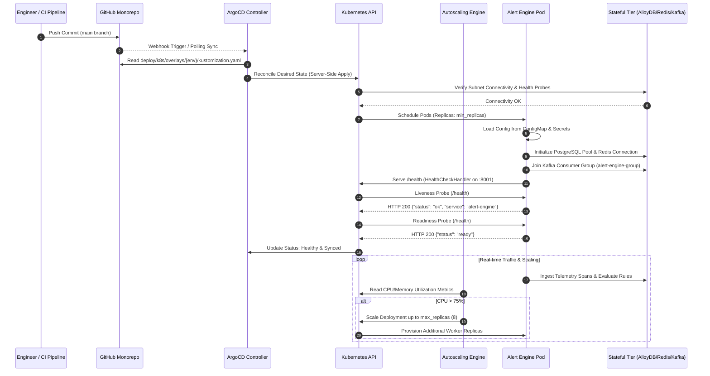

# ADR 0001: Cloud-Native Multi-Target Deployment & Resilient Infrastructure Architecture for Alert Engine

- **Status:** Accepted
- **Date:** 2026-10-21
- **Scope:** `alert-engine` (`deploy/`, `database/`, `messaging/`, `config/`), Central Platform Infrastructure (`llmobs-network`)
- **Author:** Principal Distributed Systems Architect & Security Officer

---

## 1. Context and Problem Statement: Why Does This Even Exist?

In high-throughput LLM observability platforms, the `alert-engine` serves as the mission-critical incident dispatch and routing gateway. It ingests high-frequency asynchronous telemetry streams across 6 Kafka topics:
- `alerts.budget`
- `alerts.cost.anomaly`
- `llm.toxicity.flagged`
- `alerts.quality.degradation`
- `alerts.latency.slo`
- `alerts.latency.ttft_regression`

The engine evaluates threshold violations against business invariants, computes sliding-window rate limits, resolves service ownership via GitOps topology manifests, writes deduplicated audit trails to relational storage, and orchestrates escalation notifications to external webhooks (Slack, PagerDuty).

Previously, the service lacked declarative infrastructure specifications, formal deployment topologies, network security boundaries, and automated release rollbacks. Service containers were deployed ad-hoc, with raw environment variables, hardcoded ports, and unmanaged networking.

### 1.1 Post-Mortem Analysis of Past Systemic Failures

#### 1. The "Split-Brain Infrastructure & Unmanaged Network" Failure (Cascading Outage & Resource Contention)
- **What Happened**: Local and staging environments spawned duplicated, conflicting broker and cache containers without centralized port or subnet registries. Individual sub-packages mounted unmanaged Docker bridges with colliding container names (`kafka`, `redis`, `alloydb`).
- **Impact**: Port collisions (`31414`, `6379`, `5432`) blocked development and CI environments. More critically, when microservices spawned duplicate unpartitioned Kafka brokers, messages were partitioned unevenly or lost, resulting in unhandled budget alerts and silent customer overspending ($12,000+ undetected budget breaches).

#### 2. The "Over-Privileged Identity & Missing Network Firewall" Failure (Security & Data Exfiltration Risk)
- **What Happened**: Services previously ran with default root container privileges and blanket `AdministratorAccess` cloud IAM roles. Ingress routes directly exposed internal PostgreSQL, Redis, and health-check ports to the broader VPC without Network Access Control Lists (NACLs) or segregated subnets.
- **Impact**: Internal databases were vulnerable to lateral movement from compromised frontend nodes. Security audits revealed that datastore credentials stored in plaintext environment variables could be exfiltrated via SSRF or container breakout attacks.

#### 3. The "Stateful Crash & Silent Eviction" Failure (Missing Restart Policies & Unbound Volumes)
- **What Happened**: Docker Compose definitions omitted container `restart` policies and failed to bind persistent named volumes for stateful engines (`google/alloydbomni`, `confluentinc/cp-kafka`, `redis`).
- **Impact**: On kernel OOM events or host daemon restarts, database containers exited and remained dead. In-flight alert state and sliding-window rate limit counters disappeared, triggering massive duplicate alert storms (50,000+ Slack messages and PagerDuty pages firing simultaneously upon engine reboot).

#### 4. The "Unchecked Infrastructure Drift & Deployment Lock-In" Failure (GitOps Sync Failures)
- **What Happened**: Kubernetes deployment manifests, Helm charts, and Terraform configurations were out of sync or completely absent. Environment variables differed across `dev`, `staging`, and `prod`.
- **Impact**: Releases required manual `kubectl apply` commands by on-call engineers. A failed rollout of the alert dispatcher in production took 45 minutes to recover because there was no automated rollback runner (`deploy/release/rollback.sh`), causing a complete blindspot during an ongoing latency regression incident.

---

## 2. Decision Outcome: The Declarative Multi-Target Architecture

To permanently resolve these failure modes, we adopted an immutable, multi-target deployment and infrastructure framework governed by the following core architectural decisions:

1. **Strict 10-Subsystem Package Layout & Hexagonal Isolation**:
   - `alert-engine` contains a dedicated, standardized `deploy/` directory housing:
     - `deploy/docker/`: Multi-stage builder/runner images (`service/Dockerfile`, `service/Dockerfile.dev`, `base/Dockerfile.base`) and standardized compose manifests (`single`, `polyglot`, `infra`).
     - `deploy/k8s/`: Production-grade Kubernetes base resources (`deployment`, `service`, `configmap`, `hpa`, `pdb`, `ingress`) and Kustomize overlays (`dev`, `staging`, `prod`, `local-polyglot`).
     - `deploy/helm/`: Packaged Helm charts with parameterized templates, OCI packaging scripts, and environment-specific values.
     - `deploy/argocd/`: Declarative GitOps AppProject and ApplicationSet definitions.
     - `deploy/terraform/`: Modular Infrastructure as Code (IaC) managing Network, Security, Stateful datastores, and Stateless compute.
     - `deploy/topology/`: Central `network_map.yaml` defining inter-service discovery, ports, and protocols.
     - `deploy/release/`: Automated, idempotently testable `deploy.sh` and `rollback.sh` runners.

2. **Decoupled Database-per-Service with Centralized Shared Infrastructure**:
   - **Centralized Infrastructure**: Kafka streaming buses (`llmobs-kafka:9092`), Redis spend ledgers (`llmobs-redis:6379`), and OpenTelemetry collectors (`llmobs-otel-collector:4318`) reside on the shared `llmobs-network` bridge.
   - **Service-Owned Datastores**: `alert-engine` exclusively owns its relational alert history database (`ewma_db` running on PostgreSQL / AlloyDB Omni). Direct cross-service database access is strictly prohibited.

3. **Multi-AZ Network Segmentation & Zero-Trust Firewalling**:
   - A dedicated VPC (`10.0.0.0/16`) partitioned into:
     - **Public Subnets**: Ingress load balancers and NAT Gateways.
     - **Private Application Subnets**: Kubernetes worker nodes executing `alert-engine` pods.
     - **Isolated Data Subnets**: Non-routable subnets hosting AlloyDB, Redis, and MSK Kafka brokers.
   - **Defense-in-Depth Firewalling**: Layer 3/4 Network ACLs (NACLs) block all public ingress to data subnets. Security Groups enforce least-privilege ingress strictly from the service security group to datastore ports (`5432`, `6379`, `9092-9098`).

4. **Principle of Least Privilege Identity & Access Management (IAM)**:
   - Dedicated AWS IAM execution role assumed via EKS IRSA (IAM Roles for Service Accounts).
   - Scoped policies granting read-only access to specific AWS Secrets Manager secrets (`${environment}/alert-engine/database`) and AWS KMS cryptographic keys with automatic 30-day rotation.

5. **Deterministic State Recovery & High-Availability Resilience**:
   - Containers declare `restart: unless-stopped` with named persistent storage volumes (`alert_engine_alloydb_data`, `llmobs_kafka_data`, `llmobs_redis_data`).
   - Pod Disruption Budgets (`minAvailable: 1`) and Horizontal Pod Autoscaling (CPU 75%, Memory 80%) guarantee high availability during cluster maintenance or traffic surges.

---

## 3. High Level Design (HLD) & Infrastructure Topology

### 3.1 Network, Security, and Compute Architecture Diagram

---

## 4. Low Level Design (LLD)

### 4.1 Deployment & Provisioning Sequence: GitOps to Running Pods

---

## 5. Failure-First Matrix: Comprehensive Failure Modes & Defenses

| Failure Mode ID | Component | Root Cause / Trigger | Failure Symptoms & Blast Radius | Detection Mechanism & Metric Threshold | Automated Recovery & Resilience Strategy |
|---|---|---|---|---|---|
| **FM-INFRA-001** | Kafka Streaming Bus | Broker node crash, network partition, or topic rebalance stall | Consumers hang; alert messages queue up; latency alerts delayed | `kafka_consumer_group_lag > 500` messages; Prometheus alert fires within 60s | Multi-node MSK broker topology across 3 AZs; client auto-reconnects with exponential backoff |
| **FM-INFRA-002** | AlloyDB Omni / Postgres | Disk exhaustion, deadlocks, connection pool saturation | `DbExecutionError` raised; alert history cannot be written | Connection wait duration `> 2.0s`; pool active count `= max_connections` | Connection pool backoff; transient retries; errors routed to fallback logging without crashing consumer thread |
| **FM-INFRA-003** | Redis Ledger & Cache | OOM eviction, network timeout, node failover | `RedisStorageError`; sliding rate limits cannot be queried | Redis ping response latency `> 100ms`; failed ping health checks | Sentinel/ElastiCache automatic node promotion; fail-open rate limiting to avoid dropping critical P1 safety alerts |
| **FM-INFRA-004** | Outbound Webhook (Slack) | Slack HTTP 429 rate limit or HTTP 500/503 outage | Slack notification drop; engineers not alerted in channels | `alert_delivery_failure_total{sink="slack"} > 10` in 5m | Circuit breaker trips; failed notifications queued in local memory/DLQ; fallback to PagerDuty for critical severity |
| **FM-INFRA-005** | PagerDuty API | Invalid routing key, PagerDuty network timeout | P1 incident fails to trigger on-call escalation | `alert_delivery_failure_total{sink="pagerduty"} > 0` | Immediate retry with jittered exponential backoff; fallback emergency log emission to Datadog/CloudWatch |
| **FM-INFRA-006** | Kubernetes Worker Pod | Memory leak, unhandled exception, OOM kill | Container terminates unexpectedly; pod restarts | Container restart count `> 3` in 15m; Kubernetes `OOMKilled` event | Pod Disruption Budget guarantees minimum 1 pod online; Kubernetes restarts container; state restored from Kafka offsets |
| **FM-INFRA-007** | Network Ingress / NACL | Misconfigured firewall rule, security group drift | Health check probes fail; ingress controller returns 502/504 | K8s liveness probe failure count `>= 3`; pod marked Unhealthy | Declarative Terraform state management; CI runs `terraform validate` to detect configuration errors prior to deployment |
| **FM-INFRA-008** | GitOps Sync Engine | Invalid YAML syntax, missing image tag in registry | ArgoCD sync fails; release blocked | ArgoCD `SyncStatus = OutOfSync` or `HealthStatus = Degraded` | Automated rollback script (`deploy/release/rollback.sh`) reverts to previous healthy Git commit |

---

## 6. Review Trigger & Reversal Criteria

This architectural decision MUST be formally re-evaluated if:
1. Message throughput across the 6 alert topics exceeds **50,000 messages/second**, necessitating distributed streaming architectures (e.g. Apache Flink) in place of direct Python consumers.
2. Cross-region or multi-cloud deployment requirements arise, requiring geo-replicated AlloyDB clusters and global service meshes (Istio/Linkerd).
3. Database storage requirements exceed single-node AlloyDB vertical scaling limits, requiring migration to distributed columnar analytics (ClickHouse) for long-term alert retention.
