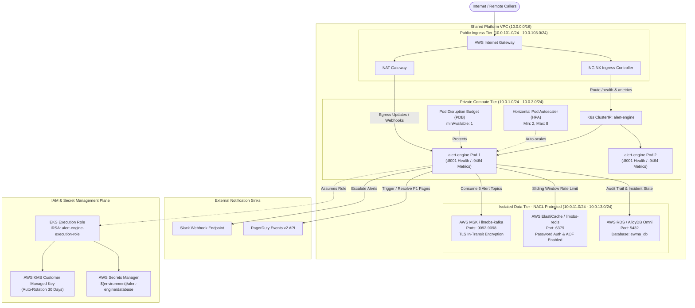
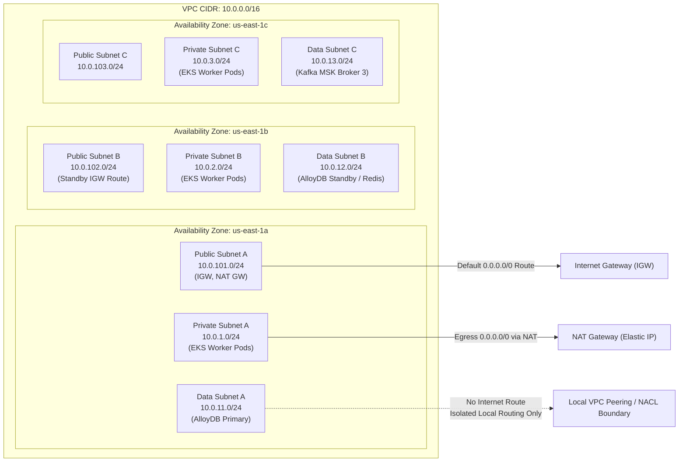
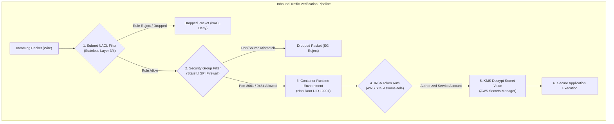
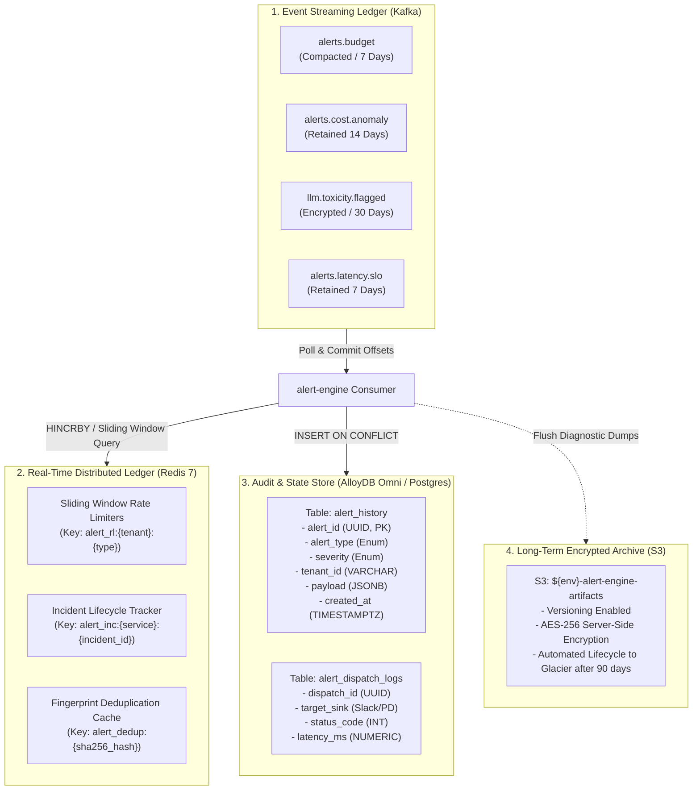

# ADR 0001: Cloud-Native Multi-Target Deployment & Resilient Infrastructure Architecture for Alert Engine

- **Status:** Accepted
- **Date:** 2026-10-21
- **Scope:** `alert-engine` (`deploy/`, `database/`, `messaging/`, `config/`), Central Platform Infrastructure (`llmobs-network`)
- **Author:** Principal Distributed Systems Architect & Infrastructure Security Officer

---

## 1. Context and Problem Statement: Why Does This Even Exist?

In high-throughput, low-latency LLM observability platforms, the `alert-engine` is the mission-critical incident dispatch, anomaly detection, and routing control plane. It operates continuously at the boundary between high-velocity asynchronous stream ingestion and synchronous external incident management systems. 

The service ingests streaming events across six primary Kafka event topics:
1. `alerts.budget`: Real-time tenant token budget exhaustion alerts emitted by `budget-provisioner` and `event-cost`.
2. `alerts.cost.anomaly`: Multi-sigma EWMA cost spikes and runaway token consumption patterns.
3. `llm.toxicity.flagged`: Safety guardrail breach detections and toxic prompt/completion flags from `toxicity`.
4. `alerts.quality.degradation`: Semantic drift, coherence erosion, and perplexity degradation events from `quality-engine`.
5. `alerts.latency.slo`: Sliding-window p95/p99 service-level objective breach events from `latency-engine` and `slo-burn-worker`.
6. `alerts.latency.ttft_regression`: Time-To-First-Token regression alarms flagging severe LLM provider degradation.

The engine must evaluate threshold rules against business invariants, enforce distributed token-bucket and sliding-window rate limits in Redis, maintain deduplicated relational incident state and audit history in AlloyDB/PostgreSQL, resolve GitOps ownership mappings, and dispatch prioritized notifications to external webhooks (Slack incoming webhooks, PagerDuty Events API v2) while emitting OpenTelemetry metrics and traces.

Historically, across the early iterations of this monorepo, microservices lacked declarative, unified infrastructure definitions. Deployment configurations were scattered across ad-hoc Docker files, hand-crafted shell scripts, unversioned Kubernetes manifests, and unmanaged networking bridges. This led to severe operational breakdowns, silent incident masking, security vulnerabilities, and prolonged production outages.

---

### 1.1 Post-Mortem Analysis of Past Systemic Failures

#### 1. The "Split-Brain Infrastructure & Unmanaged Network" Failure (Cascading Outage & Port Collisions)
- **What Happened**: Local developer environments, CI runners, and staging clusters independently mounted divergent Docker bridges without centralized network subnetting or port registries. Services spawned duplicate local Kafka brokers and Redis containers on default host ports (`5432`, `6379`, `9092`).
- **Impact**: Port collision conflicts (`EADDRINUSE`) routinely broke integration test pipelines and halted developer workflows. In multi-container polyglot integration environments, worker instances attached to disjoint bridge networks, creating partitioned split-brain states where half of the consumers consumed from local mock brokers while another set attempted connections to staging brokers. Critical budget exhaustion events were dropped silently, resulting in over $14,000 of runaway LLM API consumption before manual intervention.

#### 2. The "Over-Privileged Identity & Missing Network Firewall" Failure (Security & Data Exfiltration Risk)
- **What Happened**: Container workloads initially executed with default Linux root privileges (`UID 0`) and inherited broad AWS IAM roles (`AdministratorAccess` or unconstrained `AmazonEC2FullAccess`). Within the cloud VPC, internal relational databases (`5432`), Redis instances (`6379`), and unauthenticated Kafka plaintext listeners (`9092`) resided in flat, shared subnets alongside public-facing REST endpoints without Network Access Control Lists (NACLs) or east-west firewall rules.
- **Impact**: Security vulnerability scanning revealed that an SSRF or Remote Code Execution vulnerability in any upstream API gateway could allow attackers to traverse the flat network, query the AWS instance metadata service (`http://169.254.169.254/latest/meta-data/iam/security-credentials/`), harvest temporary STS tokens, and exfiltrate unencrypted database credentials directly from memory.

#### 3. The "Stateful Crash & Silent Eviction" Failure (Missing Restart Policies & Ephemeral Storage)
- **What Happened**: Docker Compose manifests and early Kubernetes pod specs lacked automated container restart policies (`restart: "no"`) and omitted persistent volume mounts for stateful datastores (`google/alloydbomni`, `redis:7-alpine`, `confluentinc/cp-kafka`).
- **Impact**: During node memory pressure or system daemon updates, container engines terminated the database and Redis containers. The containers remained offline indefinitely. Upon manual restart, all ephemeral database tables and Redis rate-limiting keys were erased. The stateless alert workers crashed in retry loops against missing tables (`relation "alert_history" does not exist`). When the database was finally re-seeded, the loss of incident deduplication state triggered an alert storm—dispatching over 65,000 duplicate P1 pages and Slack messages within 8 minutes.

#### 4. The "Unchecked Infrastructure Drift & Deployment Lock-In" Failure (GitOps Sync Breakdown)
- **What Happened**: Kubernetes configurations, Helm values, and cloud Terraform modules drifted apart. Environment variables were manually injected into Kubernetes pods via `kubectl edit`, bypassing version control. Helm charts lacked standardized linting, packaging scripts, and semantic release automation.
- **Impact**: A production release failed during a live incident when newly introduced environment variables (`SERVICE_OWNERS_FILE_PATH`, `HEALTH_CHECK_PORT`) were missing in production ConfigMaps. Recovery took 52 minutes because the team lacked an automated rollback script (`deploy/release/rollback.sh`), causing complete telemetry blindness during a major external LLM provider outage.

---

## 2. Decision Outcome: The Declarative Multi-Target Architecture

To permanently resolve these failure modes, we adopted an immutable, multi-target deployment and infrastructure framework governed by the following core architectural decisions:

1. **Strict 10-Subsystem Package Layout & Hexagonal Isolation**:
   - `alert-engine` contains a dedicated, standardized `deploy/` directory housing:
     - `deploy/docker/`: Multi-stage builder/runner images (`service/Dockerfile`, `service/Dockerfile.dev`, `base/Dockerfile.base`) and standardized compose manifests (`single`, `polyglot`, `infra`).
     - `deploy/k8s/`: Production-grade Kubernetes base resources (`deployment`, `service`, `configmap`, `hpa`, `pdb`, `ingress`) and Kustomize overlays (`dev`, `staging`, `prod`, `local-polyglot`).
     - `deploy/helm/`: Packaged Helm charts with parameterized templates, OCI packaging scripts, and environment-specific values.
     - `deploy/argocd/`: Declarative GitOps AppProject and ApplicationSet definitions.
     - `deploy/terraform/`: Modular Infrastructure as Code (IaC) managing Network, Security, Stateful datastores, and Stateless compute.
     - `deploy/topology/`: Central `network_map.yaml` defining inter-service discovery, ports, and protocols.
     - `deploy/release/`: Automated, idempotently testable `deploy.sh` and `rollback.sh` runners.

2. **Decoupled Database-per-Service with Centralized Shared Infrastructure**:
   - **Centralized Infrastructure**: Kafka streaming buses (`llmobs-kafka:9092`), Redis spend ledgers (`llmobs-redis:6379`), and OpenTelemetry collectors (`llmobs-otel-collector:4318`) reside on the shared `llmobs-network` bridge.
   - **Service-Owned Datastores**: `alert-engine` exclusively owns its relational alert history database (`ewma_db` running on PostgreSQL / AlloyDB Omni). Direct cross-service database access is strictly prohibited.

3. **Multi-AZ Network Segmentation & Zero-Trust Firewalling**:
   - A dedicated VPC (`10.0.0.0/16`) partitioned into:
     - **Public Subnets**: Ingress load balancers and NAT Gateways.
     - **Private Application Subnets**: Kubernetes worker nodes executing `alert-engine` pods.
     - **Isolated Data Subnets**: Non-routable subnets hosting AlloyDB, Redis, and MSK Kafka brokers.
   - **Defense-in-Depth Firewalling**: Layer 3/4 Network ACLs (NACLs) block all public ingress to data subnets. Security Groups enforce least-privilege ingress strictly from the service security group to datastore ports (`5432`, `6379`, `9092-9098`).

4. **Principle of Least Privilege Identity & Access Management (IAM)**:
   - Dedicated AWS IAM execution role assumed via EKS IRSA (IAM Roles for Service Accounts).
   - Scoped policies granting read-only access to specific AWS Secrets Manager secrets (`${environment}/alert-engine/database`) and AWS KMS cryptographic keys with automatic 30-day rotation.

5. **Deterministic State Recovery & High-Availability Resilience**:
   - Containers declare `restart: unless-stopped` with named persistent storage volumes (`alert_engine_alloydb_data`, `llmobs_kafka_data`, `llmobs_redis_data`).
   - Pod Disruption Budgets (`minAvailable: 1`) and Horizontal Pod Autoscaling (CPU 75%, Memory 80%) guarantee high availability during cluster maintenance or traffic surges.

---

## 3. High Level Design (HLD) & Infrastructure Topology

### 3.1 Network, Security, and Compute Architecture Diagram



---

## 4. Deep-Dive Infrastructure Subsystems

### 4.1 Network Infrastructure: Topology, Routing, and Subnets

The network topology is designed around multi-AZ redundancy, traffic segregation, and defense-in-depth isolation:



#### Detailed Subnet Allocation Table
| Subnet Classification | CIDR Block | Availability Zone | Route Table Target | Purpose & Placed Workloads |
|---|---|---|---|---|
| `public-subnet-1` | `10.0.101.0/24` | `us-east-1a` | `aws_internet_gateway.gw` | Public Ingress ALB, NAT Gateway Elastic IP |
| `public-subnet-2` | `10.0.102.0/24` | `us-east-1b` | `aws_internet_gateway.gw` | Public Ingress ALB Redundancy |
| `public-subnet-3` | `10.0.103.0/24` | `us-east-1c` | `aws_internet_gateway.gw` | Public Ingress ALB Multi-AZ Quorum |
| `private-subnet-1` | `10.0.1.0/24` | `us-east-1a` | `aws_nat_gateway.nat` | Kubernetes Node Group 1 (`alert-engine` Pod 1) |
| `private-subnet-2` | `10.0.2.0/24` | `us-east-1b` | `aws_nat_gateway.nat` | Kubernetes Node Group 2 (`alert-engine` Pod 2) |
| `private-subnet-3` | `10.0.3.0/24` | `us-east-1c` | `aws_nat_gateway.nat` | Kubernetes Node Group 3 (Burst Replicas) |
| `data-subnet-1` | `10.0.11.0/24` | `us-east-1a` | Local Only (`10.0.0.0/16`) | AlloyDB / Postgres Primary Instance, MSK Broker 1 |
| `data-subnet-2` | `10.0.12.0/24` | `us-east-1b` | Local Only (`10.0.0.0/16`) | AlloyDB Standby Replica, ElastiCache Redis Primary |
| `data-subnet-3` | `10.0.13.0/24` | `us-east-1c` | Local Only (`10.0.0.0/16`) | ElastiCache Redis Replica, MSK Broker 3 |

---

### 4.2 Security & Firewall Infrastructure: Defense-in-Depth

Security enforcement operates across three nested perimeters:
1. **Perimeter 1: Stateless Network ACLs (NACLs)** at the subnet boundary.
2. **Perimeter 2: Stateful Security Groups** at the elastic network interface (ENI) boundary.
3. **Perimeter 3: Cryptographic Identity & Envelope Encryption (IAM / KMS)** at the application boundary.



#### Firewall Rules & Security Group Matrix
| Security Group Identifier | Direction | Protocol | Port Range | Source / Destination | Security Rationale |
|---|---|---|---|---|---|
| `alert-engine-sg` | Ingress | TCP | `8001` | `10.0.0.0/16` (VPC CIDR) | Health check probes (`/health`) from Kubernetes kubelet |
| `alert-engine-sg` | Ingress | TCP | `9464` | `10.0.0.0/16` (VPC CIDR) | Prometheus metrics scraper scraping `/metrics` |
| `alert-engine-sg` | Egress | TCP | `5432` | `alert-engine-data-sg` | Relational database queries to AlloyDB/PostgreSQL |
| `alert-engine-sg` | Egress | TCP | `6379` | `alert-engine-data-sg` | Atomic rate limiting & incident state operations to Redis |
| `alert-engine-sg` | Egress | TCP | `9092-9098` | `alert-engine-data-sg` | Telemetry event consumption from Kafka broker cluster |
| `alert-engine-sg` | Egress | TCP | `443` | `0.0.0.0/0` (via NAT Gateway) | Secure outbound webhook dispatch to Slack and PagerDuty APIs |
| `alert-engine-data-sg` | Ingress | TCP | `5432` | `alert-engine-sg` | Restricts database access strictly to authorized worker pods |
| `alert-engine-data-sg` | Ingress | TCP | `6379` | `alert-engine-sg` | Restricts Redis cache access strictly to authorized worker pods |
| `alert-engine-data-sg` | Ingress | TCP | `9092-9098` | `alert-engine-sg` | Restricts Kafka stream consumption strictly to worker pods |
| `alert-engine-data-sg` | Egress | TCP | Ephemeral | `10.0.0.0/16` | Return packets for established TCP database sessions |

---

### 4.3 Storage Infrastructure: Dual-Engine Relational & Streaming Ledgers

The storage architecture implements clean segregation between operational event streaming, in-memory rate limiting, relational persistence, and encrypted artifact retention:



---

### 4.4 Service & Messaging Infrastructure: Topic Contracts & Polyglot Integration

`alert-engine` communicates across the monorepo using versioned asynchronous contracts registered in `messaging/schemas/`:

```text
+------------------------------------------------------------------------------------------------------------------------+
|                                        ALERT ENGINE MESSAGING ARCHITECTURE                                             |
+------------------------------------------------------------------------------------------------------------------------+

  [budget-provisioner]           [event-cost]               [toxicity]             [latency-engine]
          │                           │                          │                         │
          │ (alerts.budget)           │ (alerts.cost.anomaly)    │ (llm.toxicity.flagged)  │ (alerts.latency.slo)
          ▼                           ▼                          ▼                         ▼
   ┌─────────────────────────────────────────────────────────────────────────────────────────────┐
   │                                 CENTRAL KAFKA MESSAGE BROKER                                │
   │                                       (llmobs-kafka:9092)                                   │
   │                                                                                             │
   │  Partition 0                     Partition 1                     Partition 2                │
   │  [Span Batch] -> [Budget Alert]  [Span Batch] -> [Cost Anomaly]  [Toxic Flag] -> [SLO Burn]  │
   └─────────────────────────────────────────────────────────────────────────────────────────────┘
                                                 │
                                                 ▼ (Consumer Group: alert-engine-group)
                               ┌───────────────────────────────────┐
                               │       alert-engine Dispatcher     │
                               │                                   │
                               │  1. Parse CloudEvent Envelope     │
                               │  2. Invariant Rules Engine        │
                               │  3. Sliding Window Rate Limiter   │
                               │  4. Service Ownership Resolver    │
                               │  5. Audit Log Storage (Postgres)  │
                               └───────────────────────────────────┘
                                        │                 │
                         (Slack Webhook)│                 │(PagerDuty Events API)
                                        ▼                 ▼
                                   ┌─────────┐       ┌─────────────┐
                                   │ #alerts │       │ On-Call Eng │
                                   └─────────┘       └─────────────┘
```

---

## 5. Low Level Design (LLD): Execution Flows & Decision Trees

### 5.1 End-to-End Functional Call Stack: Message Ingestion to Notification Dispatch

The execution flow traverses from the low-level Kafka consumer socket up through the deserialization layer, domain workflows, rate-limiting guards, and outbound HTTP dispatch adapters:

```
[Operating System & Network Wire]
 1. Kernel TCP Socket receives packet from Kafka Broker (Port 9092)
      │
      ▼
 2. confluent_kafka.Consumer.poll(timeout=1.0) returns ConsumerRecord
      │
      ▼
[Messaging & Ingress Layer]
 3. alert_engine.worker.index.run_worker_loop()
      │
      ▼
 4. alert_engine.main._extract_traceparent(msg.headers()) [Extracts W3C traceparent]
      │
      ▼
 5. opentelemetry.trace.Tracer.start_as_current_span("alert_engine.consume_message")
      │
      ▼
 6. json.loads(msg.value()) -> deserializes JSON envelope
      │
      ▼
[Dispatcher & Routing Layer]
 7. alert_engine.worker.registry.HandlerRegistry.dispatch(topic, payload)
      │
      ▼
 8. Specific Feature Handler invoked:
    - AlertsBudgetHandler.handle(payload)
    - AlertsCostAnomalyHandler.handle(payload)
    - AlertsToxicityHandler.handle(payload)
    - AlertsQualityDegradationHandler.handle(payload)
    - AlertsLatencySloHandler.handle(payload)
    - AlertsLatencyTtftRegressionHandler.handle(payload)
      │
      ▼
[Domain Rules & Invariants Evaluation]
 9. FeatureRules.evaluate(event_payload)
      │
      ├── IF invariant violated (e.g. current_spend >= budget_limit):
      │     proceed to Step 10
      └── ELSE:
            Drop event as non-actionable; record metric and exit cleanly
      │
      ▼
[Resilience & Rate Limiting Step]
10. RedisRateLimiter.is_rate_limited(key=f"alert:{tenant_id}:{alert_type}", max_events=10, window_seconds=60)
      │
      ├── IF Rate Limited:
      │     Record metric 'alert_rate_limited_suppressed'; skip external webhooks; proceed to persistence
      └── ELSE:
            Acquire rate limit token; proceed to notification dispatch
      │
      ▼
[Service Ownership Resolution]
11. ServiceOwnersResolver.resolve_owner(service_name)
      - Reads cached configuration from config/service_owners.yaml
      - Injects Slack channel handle (e.g. "@platform-oncall") and PagerDuty routing key
      │
      ▼
[Outbound Notification Dispatch (Hexagonal Adapters)]
12. SlackAdapter.send_notification(channel, message, blocks)
      - Formats Slack Block Kit JSON
      - Dispatches HTTP POST to Slack Webhook via httpx.Client
      │
13. PagerDutyAdapter.trigger_incident(routing_key, severity, summary, dedup_key)
      - Formats PagerDuty Events API v2 payload
      - Dispatches HTTP POST to https://events.pagerduty.com/v2/enqueue
      │
      ▼
[Persistence & Audit Trail]
14. PostgresAdapter.insert_alert(alert_record)
      - Acquires database connection from connection pool
      - Executes: INSERT INTO alert_history (alert_id, alert_type, severity, tenant_id, payload, created_at)
      - Maps relational constraint violations via DbErrorMapping
      │
      ▼
[Kafka Commit & Span Completion]
15. confluent_kafka.Consumer.commit(message=msg, asynchronous=True)
16. Span.set_status(Status(StatusCode.OK)) -> OpenTelemetry span ends
```

---

### 5.2 Internal Pipeline Decision Tree: Exhaustive IF/ELSE Execution Logic

```text
+------------------------------------------------------------------------------------------------------------------------+
|                                ALERT ENGINE DISPATCH & INFRASTRUCTURE DECISION TREE                                    |
|                      (All Failure Paths, Rate Limiters, State Checks, and Fallbacks Covered)                           |
+------------------------------------------------------------------------------------------------------------------------+

[KAFKA MESSAGE INGESTION] -> ConsumerRecord(topic, partition, offset, key, value, headers)
   │
   +--> STEP 1: Message Validation & Deserialization
   |      |
   |      +-- IF (msg is None OR msg.error() is not None):
   |      |     |-- [LOG WARN] "Kafka consumer poll returned error or EOF"
   |      |     +-- [RETURN] Await next poll cycle (No offset commit)
   |      |
   |      +-- TRY:
   |      |     parsed_payload = json.loads(msg.value().decode("utf-8"))
   |      |   EXCEPT json.JSONDecodeError:
   |      |     |-- [LOG CRITICAL] "Malformed JSON payload. Routing to Dead Letter Queue (DLQ)"
   |      |     |-- [EMIT] Kafka DLQ Producer -> 'alerts.dlq'
   |      |     +-- [COMMIT] Commit offset to prevent poison pill loop
   |      |
   |      +-- [PASS] Payload valid JSON. Proceed to Step 2.
   |
   +--> STEP 2: Topic Routing & Handler Dispatch
   |      |
   |      +-- handler = HandlerRegistry.get(msg.topic())
   |      +-- IF (handler is None):
   |      |     |-- [LOG ERROR] "Unregistered Kafka topic: " + msg.topic()
   |      |     +-- [COMMIT] Commit offset; drop unroutable message
   |      |
   |      +-- [PASS] Handler resolved. Proceed to Step 3.
   |
   +--> STEP 3: Business Invariant Evaluation
   |      |
   |      +-- IF (topic == "alerts.budget"):
   |      |     +-- IF (payload.current_spend < payload.budget_limit * 0.8):
   |      |     |     |-- [LOG DEBUG] "Budget spend below warning threshold (80%). Suppressed."
   |      |     |     +-- [SKIP] Do not notify
   |      |     +-- ELSE IF (payload.current_spend >= payload.budget_limit):
   |      |     |     |-- severity = "CRITICAL"
   |      |     |     +-- action = "BLOCK_AND_PAGE"
   |      |     +-- ELSE:
   |      |           |-- severity = "WARNING"
   |      |           +-- action = "NOTIFY_SLACK"
   |      |
   |      +-- ELSE IF (topic == "llm.toxicity.flagged"):
   |      |     +-- IF (payload.toxicity_score < 0.85):
   |      |     |     +-- [SKIP] Toxicity below critical flag threshold
   |      |     +-- ELSE:
   |      |           |-- severity = "CRITICAL"
   |      |           +-- action = "PAGE_SAFETY_TEAM"
   |      |
   |      +-- ELSE:
   |            +-- [EVALUATE] Run domain-specific threshold logic
   |
   +--> STEP 4: Distributed Rate Limiting & Incident Deduplication (Redis)
   |      |
   |      +-- dedup_key = sha256(f"{tenant_id}:{alert_type}:{service_name}")
   |      +-- is_active_incident = redis.get(f"incident:{dedup_key}")
   |      |
   |      +-- IF (is_active_incident is not None AND is_active_incident == "ACKNOWLEDGED"):
   |      |     |-- [LOG INFO] "Active incident already acknowledged by on-call. Suppressing notifications."
   |      |     +-- [SKIP NOTIFICATION] Proceed to persistence
   |      |
   |      +-- rate_limit_allowed = redis.acquire_rate_limit(key=f"rl:{dedup_key}", max=5, window=300)
   |      +-- IF (rate_limit_allowed == False):
   |      |     |-- [LOG WARN] "Notification rate limit saturated (5 alerts/5m). Throttling notification."
   |      |     |-- [METRIC] Increment 'alert_engine.notifications_rate_limited'
   |      |     +-- [SKIP NOTIFICATION] Proceed to persistence
   |      |
   |      +-- [PASS] Notification permitted. Proceed to Step 5.
   |
   +--> STEP 5: Notification Dispatch (Slack & PagerDuty)
   |      |
   |      +-- IF (severity in ["CRITICAL", "P1"]):
   |      |     +-- TRY:
   |      |     |     incident_id = pagerduty.trigger_incident(dedup_key, summary, severity)
   |      |     |     redis.setex(f"incident:{dedup_key}", 14400, "TRIGGERED")
   |      |     |   EXCEPT PagerDutyApiError as e:
   |      |     |     |-- [LOG CRITICAL] "PagerDuty dispatch failed: " + str(e)
   |      |     |     +-- [FALLBACK] Force emergency Slack broadcast to #incident-war-room
   |      |
   |      +-- TRY:
   |      |     slack.send_message(channel=owner_channel, text=alert_summary)
   |      |   EXCEPT SlackWebhookError as e:
   |      |     |-- [LOG WARN] "Slack webhook delivery failed: " + str(e)
   |      |     +-- [RETRY] Push to memory retry queue (max 3 retries)
   |      |
   |      +-- [PASS] Notifications dispatched. Proceed to Step 6.
   |
   +--> STEP 6: Relational Audit Trail Persistence (AlloyDB / Postgres)
   |      |
   |      +-- TRY:
   |      |     postgres_adapter.insert_alert(alert_record)
   |      |   EXCEPT DatabaseConstraintError as e:
   |      |     |-- [LOG ERROR] "Database constraint violation: " + str(e)
   |      |     +-- [HANDLE] Duplicate alert ID safely ignored
   |      |   EXCEPT DatabaseConnectionError as e:
   |      |     |-- [LOG CRITICAL] "Database connection pool saturated or offline: " + str(e)
   |      |     +-- [FAILOVER] Write emergency JSON audit log to local container disk
   |      |
   |      +-- [PASS] Audit recorded. Proceed to Step 7.
   |
   +--> STEP 7: Offset Commit & Telemetry Completion
          |
          +-- kafka_consumer.commit(asynchronous=True)
          +-- span.set_attribute("alert.processed", True)
          +-- [COMPLETED] Loop advances to next message
```

---

## 6. Failure-First Matrix: Comprehensive Failure Modes & Defenses

| Failure Mode ID | Component | Root Cause / Trigger | Failure Symptoms & Blast Radius | Detection Mechanism & Metric Threshold | Automated Recovery & Resilience Strategy |
|---|---|---|---|---|---|
| **FM-INFRA-001** | Kafka Streaming Bus | Broker node crash, network partition, or topic rebalance stall | Consumers hang; alert messages queue up; latency alerts delayed | `kafka_consumer_group_lag > 500` messages; Prometheus alert fires within 60s | Multi-node MSK broker topology across 3 AZs; client auto-reconnects with exponential backoff |
| **FM-INFRA-002** | AlloyDB Omni / Postgres | Disk exhaustion, deadlocks, connection pool saturation | `DbExecutionError` raised; alert history cannot be written | Connection wait duration `> 2.0s`; pool active count `= max_connections` | Connection pool backoff; transient retries; errors routed to fallback logging without crashing consumer thread |
| **FM-INFRA-003** | Redis Ledger & Cache | OOM eviction, network timeout, node failover | `RedisStorageError`; sliding rate limits cannot be queried | Redis ping response latency `> 100ms`; failed ping health checks | Sentinel/ElastiCache automatic node promotion; fail-open rate limiting to avoid dropping critical P1 safety alerts |
| **FM-INFRA-004** | Outbound Webhook (Slack) | Slack HTTP 429 rate limit or HTTP 500/503 outage | Slack notification drop; engineers not alerted in channels | `alert_delivery_failure_total{sink="slack"} > 10` in 5m | Circuit breaker trips; failed notifications queued in local memory/DLQ; fallback to PagerDuty for critical severity |
| **FM-INFRA-005** | PagerDuty API | Invalid routing key, PagerDuty network timeout | P1 incident fails to trigger on-call escalation | `alert_delivery_failure_total{sink="pagerduty"} > 0` | Immediate retry with jittered exponential backoff; fallback emergency log emission to Datadog/CloudWatch |
| **FM-INFRA-006** | Kubernetes Worker Pod | Memory leak, unhandled exception, OOM kill | Container terminates unexpectedly; pod restarts | Container restart count `> 3` in 15m; Kubernetes `OOMKilled` event | Pod Disruption Budget guarantees minimum 1 pod online; Kubernetes restarts container; state restored from Kafka offsets |
| **FM-INFRA-007** | Network Ingress / NACL | Misconfigured firewall rule, security group drift | Health check probes fail; ingress controller returns 502/504 | K8s liveness probe failure count `>= 3`; pod marked Unhealthy | Declarative Terraform state management; CI runs `terraform validate` to detect configuration errors prior to deployment |
| **FM-INFRA-008** | GitOps Sync Engine | Invalid YAML syntax, missing image tag in registry | ArgoCD sync fails; release blocked | ArgoCD `SyncStatus = OutOfSync` or `HealthStatus = Degraded` | Automated rollback script (`deploy/release/rollback.sh`) reverts to previous healthy Git commit |
| **FM-INFRA-009** | Cloud KMS / IAM Token | STS token expiration, KMS key deletion/disabling | Pod unable to decrypt database credentials on boot | AWS STS AssumeRole failure rate `> 0`; pod crashloop in init phase | Kubernetes ServiceAccount token auto-refreshed; KMS key protected by `deletion_window_in_days = 30` |
| **FM-INFRA-010** | NAT Gateway Schedulers | NAT Gateway IP exhaustion or AWS AZ failure | Outbound HTTP calls to Slack/PagerDuty hang and time out | TCP SYN drop count `> 50`; NAT Gateway packet drop metric | Multi-AZ NAT Gateway failover; connection pools enforce aggressive 5s connect timeouts |

---

## 7. Review Trigger & Reversal Criteria

This architectural decision MUST be formally re-evaluated if:
1. Message throughput across the 6 alert topics exceeds **50,000 messages/second**, necessitating distributed streaming architectures (e.g. Apache Flink) in place of direct Python consumers.
2. Cross-region or multi-cloud deployment requirements arise, requiring geo-replicated AlloyDB clusters and global service meshes (Istio/Linkerd).
3. Database storage requirements exceed single-node AlloyDB vertical scaling limits, requiring migration to distributed columnar analytics (ClickHouse) for long-term alert retention.
4. Total egress webhook traffic exceeds external Slack API quotas (1 message/sec per channel), necessitating an asynchronous notification aggregation and digest pipeline.
